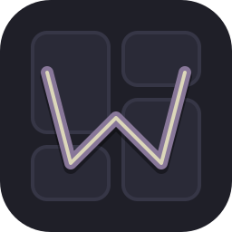
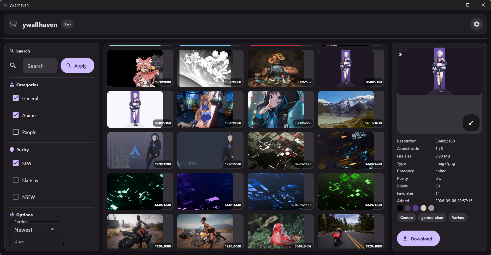
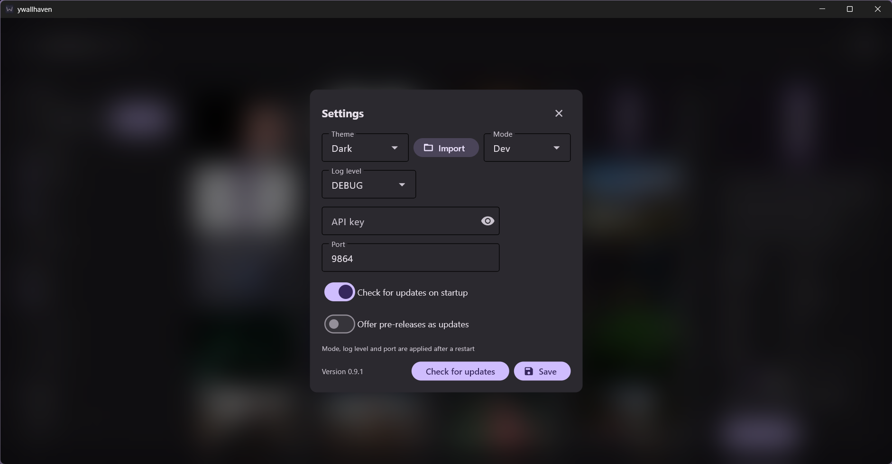
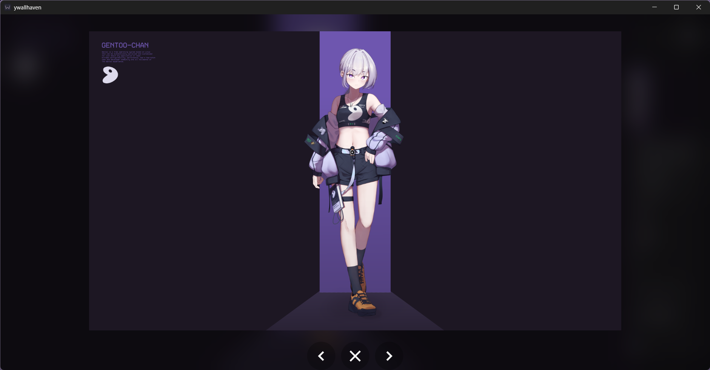
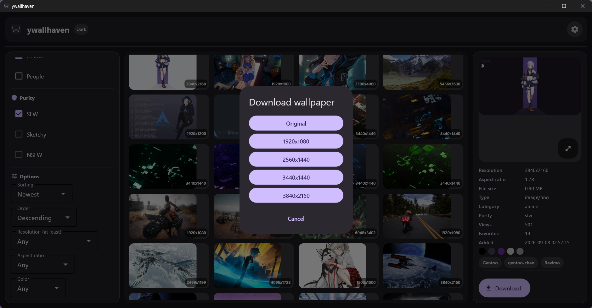

# 🖼 ywallhaven

🌐 Language / Язык **README**: [Русский](README.md) · **English**



> **Short description:** 🖼️🔍 A desktop GUI app for searching, browsing and downloading wallpapers from [Wallhaven](https://wallhaven.cc/). Built on an async Python stack and [Flet](https://flet.dev/) — no browser, no clutter, just a native window.

## ❔ Why this project?

A personal Wallhaven client: search, filter and download wallpapers straight from a standalone app, without opening the site in a browser.

## 🛠 Tech stack

- **Language:** `Python 3.13`
- **GUI framework:** `Flet`
- **HTTP client:** `httpx` (async)
- **Validation/config:** `Pydantic` + `pydantic-settings`
- **Package manager:** `uv` (build backend: `hatchling` + `hatch-vcs`)
- **Build:** `PyInstaller` (Windows `exe` + Linux AppImage via `appimagetool`)
- **Extra:** `Pillow` (image resizing), `packaging` (semver)
- **Tests:** `pytest`, `pytest-asyncio`, `pytest-cov`
- **Data source:** [Wallhaven API](https://wallhaven.cc/help/api)

## 🧭 Table of contents

- [🖼 ywallhaven](#-ywallhaven)
  - [❔ Why this project?](#-why-this-project)
  - [🛠 Tech stack](#-tech-stack)
  - [📸 Preview/gallery](#-previewgallery)
  - [💜 User guide](#-user-guide)
    - [🔽 Install / Quick start](#-install--quick-start)
    - [🖱 Daily use](#-daily-use)
    - [♻ Auto-update](#-auto-update)
    - [❓ FAQ](#-faq)
    - [🔑 API key: lifting Wallhaven limits](#-api-key-lifting-wallhaven-limits)
  - [💻 Developer sections](#-developer-sections)
    - [🧰 Project setup](#-project-setup)
    - [📦 Building](#-building)
    - [♻ Auto-update system](#-auto-update-system)
    - [🎨 Theme system](#-theme-system)
    - [📚 Collections system](#-collections-system)
    - [🧪 Tests](#-tests)
    - [📑 Config structure](#-config-structure)
  - [🗄 Project structure](#-project-structure)
  - [☑ Roadmap / Planned](#-roadmap--planned)
  - [📄 License](#-license)
  - [🤝 Contribution guidelines](#-contribution-guidelines)
  - [💜 Questions, contacts / FAQ](#-questions-contacts--faq)

## 📸 Preview/gallery

Full theme gallery: [SHOWING THEMES](docs/SHOWING%20THEMES.md). The `dark_default` theme is shown here:






## 💜 User guide

### 🔽 Install / Quick start

> [!WARNING]
> One important request to regular users: please **do NOT** download `pre-release` builds — they are for developers and testers.
> They may contain bugs and broken features. In short, those are **beta/alpha** versions.

#### 🪟 Windows

The plan:

1. Go to the releases page: [Releases](https://github.com/Sh1yden/ywallhaven/releases).
2. Download `ywallhaven_portable-vX.Y.Z.zip` (it contains a `ywallhaven` folder with both `exe` files). Prefer single files — grab `ywallhaven.exe` + `ywallhaven-updater.exe` separately.
3. Optionally verify integrity (compare the hash against `SHA256SUMS.txt` from the same release):

```shell
certutil -hashfile ywallhaven.exe SHA256
```

1. Unpack wherever you like and run `ywallhaven.exe` 💜.

On first launch, `config.json` (default settings), `favorites.json` (favorites and collections), a `logs` folder (logs) and a `themes` folder (custom themes + an in-folder guide with examples) are created next to the app. [`config.example.json`](config.example.json) is a commented cheat sheet; a ready-to-use set of values is in the [Config structure](#-config-structure) section.

#### 🐧 Linux

1. Go to the releases page: [Releases](https://github.com/Sh1yden/ywallhaven/releases).
2. Download `YWallhaven-vX.Y.Z-x86_64.AppImage`.
3. Optionally verify integrity: `sha256sum -c SHA256SUMS.txt` (the file from the same release).
4. Put the AppImage anywhere convenient in your home directory (not in system folders).
5. Make it executable and run it (or just launch it from your file manager):

```shell
chmod +x YWallhaven-vX.Y.Z-x86_64.AppImage
./YWallhaven-vX.Y.Z-x86_64.AppImage
```

If the system won't launch the AppImage, install `libfuse2` or run `./YWallhaven-vX.Y.Z-x86_64.AppImage --appimage-extract-and-run` — see the [FAQ](#-faq).

### 🖱 Daily use

- **Search:** type a query on the left and tune the filters: categories (`General`, `Anime`, `People`), `purity` (`SFW`, `Sketchy`, `NSFW`), sorting and order, minimum resolution, aspect ratio, color and `toplist` range. Text applies after a 0.5 s delay or on Enter; filters apply immediately. You can also search by tag by clicking a tag under the preview, or by color via the color circles there — the filter fills itself in.
- **Preview:** clicking a gallery image in the middle shows its properties and tags on the right. Double-click opens the download dialog right away.
- **Download:** the `Download` button → `Original` or a suitable resolution preset → save dialog. If a preset is larger than the source image (for example, for a portrait wallpaper), it is not offered.
- **Wallpaper in one click:** the wallpaper button next to `Download` sets the current art as your desktop background. Windows fits the image to the screen; on Linux the install is delegated to the desktop environment or Noctalia. Animated images are not supported.
- **Fullscreen:** click the preview → `←/→` buttons flip through, wheel/`−/+` buttons zoom (zoom follows the cursor), tapping the backdrop while zoomed does not close the window (misclick protection).
- **Settings:** theme, API key, `MODE`, `LOG_LVL`, `PORT`, update-check flags and theme import. `MODE`, `LOG_LVL` and `PORT` apply after a restart; the theme and API key apply immediately.
- **Themes:** Settings → Theme (9 built-in, including Kanagawa). For your own theme, drop `themes/my_theme.json` next to `config.json` or use the `Import` button in settings.
- **Favorites and collections:** the heart on a thumbnail adds to Favorites in one click, `+` opens the collections picker (collections already containing the wallpaper are marked with a checkmark). The heart in the header opens collections mode: tiles with covers, creation, properties, full download (ZIP or folder) and slideshow. Inside an open collection the corner cross removes a wallpaper; long-press enables multi-select (delete / download / move / slideshow). More in the [Collections system](#-collections-system) section.

### ♻ Auto-update

The app checks releases on startup when `CHECK_UPDATES` is enabled, and via the `Check for updates` button in settings. The flow:

1. Offers the new version in a dialog.
2. Downloads the release file with a progress bar and verifies SHA-256 against the digest from the GitHub API, when one is published.
3. Windows: shows the standard UAC prompt (that's fine — the helper updates the exe in the install folder) → replaces the file and restarts the app.
4. Declined the UAC prompt — no harm done, you stay on the current version and get asked again later.

On Linux it is fully quiet: the helper is embedded in the `AppImage`, the same SHA-256 check runs, and the file is replaced and the app restarted with no prompts — provided the AppImage file is writable. Pre-releases are offered only when `CHECK_PRERELEASES` is enabled.

### ❓ FAQ

- **A "Wallhaven is down" banner + `Retry` button in the gallery.** The Wallhaven site itself is down (happens); the app is not at fault — the error code is right on the banner. Hit `Retry` or wait: the app re-checks on its own every minute.
- **Empty grid / everything hangs while scrolling.** Most likely Wallhaven throttling — paste in an API key (section below) and it gets noticeably snappier.
- **Windows complained on launch (SmartScreen).** This no longer reproduces on current releases — verified. If the warning does appear, it is still us: verify the hash against `SHA256SUMS.txt`.
- **NSFW/sketchy doesn't search.** The site won't serve those without a key — paste in an API key (section below), it unlocks instantly with no restart.
- **The AppImage won't start.** Install `libfuse2` or run it with `--appimage-extract-and-run`.
- **Found a bug.** Open an Issue in the repo and attach a chunk from `logs/` (files named `YYYY-MM-DD-NN.jsonl`) plus the version from settings — that makes fixes way faster 💜.

### 🔑 API key: lifting Wallhaven limits

When scrolling the wallpaper gallery too fast you may hit limits on the Wallhaven side. So it is best to follow this short plan:

1. Go to the [Wallhaven](https://wallhaven.cc/) site.
2. Register on the site.
3. Go to [Account Settings](https://wallhaven.cc/settings/account), the `API Key` item.
4. Copy the `API Key` and paste it into the app: the API key field lives in the settings section.
5. Enjoy higher limits 💜.

If you are worried about data privacy, specifically about API key theft: the key is stored locally in `config.json` in plain text. Even if it is exposed, you can regenerate it using step 3 of the instructions above.

## 💻 Developer sections

### 🧰 Project setup

1. Clone the repository:

```shell
git clone "https://github.com/Sh1yden/ywallhaven.git"
cd ywallhaven
```

1. Sync the environment with `uv`:

```shell
uv sync
```

1. Run the app:

```shell
uv run app/main.py
```

For tests, see the [Tests](#-tests) section.

### 📦 Building

The main path is CI: a tag like `vX.Y.Z` is pushed, GitHub Actions builds both platforms and publishes the release itself:

- job `build` (`windows-latest`) — the `exe` pair;
- job `build-linux` (`ubuntu-22.04`) — the AppImage;
- job `release` — publishes the assets;
- tag `vX.Y.Z` → regular Release;
- tag `vX.Y.Z-rc1` / `-beta` / `-alpha` → pre-release.

Every release always contains five files: `ywallhaven.exe` (the main app, Windows), `ywallhaven-updater.exe` (the auto-update helper, Windows), `ywallhaven_portable-vX.Y.Z.zip` (a `ywallhaven` folder with both exes), `YWallhaven-vX.Y.Z-x86_64.AppImage` (the main app, Linux) and `SHA256SUMS.txt` (checksums).

Local build (PyInstaller can't cross-compile — build on the target OS):

```shell
uv run python scripts/build.py --target win    # exe pair into dist/
uv run python scripts/build.py --target linux  # dist/ywallhaven/ + helper
```

The script bakes the version into `app/core/_version.py` (+ version-info and `.ico` for Windows) and runs PyInstaller over the spec files. The Linux folder is first built into `dist/ywallhaven/`, then `scripts/make_appdir.py` prepares `dist/AppDir`, and `appimagetool` creates the AppImage:

```shell
uv run python scripts/make_appdir.py
ARCH=x86_64 APPIMAGE_EXTRACT_AND_RUN=1 ./appimagetool \
  dist/AppDir dist/YWallhaven-vX.Y.Z-x86_64.AppImage
```

### ♻ Auto-update system

The app checks GitHub Releases on startup and via the `Check for updates` button in settings. The flow:

#### 🪟 Windows

1. Semver comparison against the latest repo release.
2. Downloading `ywallhaven.exe` to a temp folder with a progress bar.
3. SHA-256 check against the digest from the GitHub API, when present.
4. Launching `ywallhaven-updater.exe` through the standard UAC prompt (an elevated helper) that waits for the app to close, replaces the executable and restarts it.

#### 🐧 Linux

Same flow but without UAC: the helper is embedded in the AppImage, the replacement target is the `$APPIMAGE` file itself, followed by `chmod +x` and a restart. The AppImage file must be writable; if it is not, the helper reports the reason.

#### Config

Behavior is controlled by fields in `config.json` (defaults are in the [Config structure](#-config-structure) section):

- `CHECK_UPDATES` — check for updates on startup;
- `CHECK_PRERELEASES` — offer pre-releases.

If the app is running from sources, update checks work, but the update cannot be applied — a packaged binary is required.

### 🎨 Theme system

#### Built-in

[SHOWING THEMES](docs/SHOWING%20THEMES.md)

9 built-in themes in total: `dark_default`, `light_default`, `midnight`, `forest`, `ocean`, `sunset`, `arctic`, `kanagawa_wave` (dark, from `rebelot/kanagawa.nvim`), `kanagawa_lotus` (light). Pick in the app: Settings → Theme.

#### Custom

##### In brief

Drop `themes/my_theme.json` next to `config.json` or hit `Import` in settings. Format:

```json
{
  "id": "my_ocean",
  "name": "My Ocean",
  "mode": "dark",
  "seed": "#0066CC",
  "colors": { "primary": "#0066CC", "surface": "#101418" }
}
```

`seed` is required (it generates the M3 palette); `colors` optionally overrides any `ColorScheme` tokens (see `themes/README.en.md` and `app/interface/themes/schema.py`). Validation: `id` — 3–32 chars `[a-z0-9_]`, `name` — 2–40 chars, `mode` — `dark`/`light`, `seed` — hex `#RGB`/`#RRGGBB`/`#RRGGBBAA`. Legacy `"dark"/"light"` in `config.json` migrate to `dark_default/light_default`; a missing theme falls back to `dark_default`.

##### More details in [THEMES README](themes/README.en.md)

### 📚 Collections system

The store is `favorites.json` next to `config.json`: wallpaper metadata only, no binary blobs. Writes are atomic, and a corrupted file is recreated with default settings.

- The built-in `Favorites` collection cannot be deleted; other collections can be created, renamed, cleared and deleted in the UI.
- Adding: the heart on a tile → `Favorites`; `+` → collection picker. Collections that already contain the wallpaper are marked with a checkmark and disabled for re-adding.
- Collections mode opens from the heart in the header: tiles with covers and counts, creation, properties, full download (ZIP or folder).
- Collection cover: last added wallpaper, selected wallpaper, icon or heart.
- Slideshow: enable, interval from 10 seconds (default 300), order `sequential`/`random`, fit `fill`/`fit`. It pauses in fullscreen and skips failed items.
- Inside an open collection the corner cross removes a wallpaper; long-press enables multi-select: delete / download / move / start slideshow.
- Collection download: ZIP streamed to disk or a folder; per-file failures are counted and reported in the final message.
- `favorites.json` also supports read-only folders (`folders`): files are never copied or modified. The current UI has no button to link a folder — existing entries are displayed and can be unlinked.

### 🧪 Tests

Tests live in the [`tests`](tests) directory. The latest run: `343 passed, 1 skipped`.

```shell
uv run pytest
```

Coverage of the application code (`app/`, `updater/`, `scripts/`) at the time of checking — `73%`:

```shell
uv run pytest --cov=app --cov=updater --cov=scripts --cov-report=term-missing
```

### 📑 Config structure

[`config.example.json`](config.example.json) is a commented cheat sheet, so it is not strict JSON. A ready-to-use set of default values:

```json
{
    "MODE": "dev",
    "LOG_LVL": "DEBUG",
    "PORT": 9864,
    "APIK": "",
    "CHECK_UPDATES": true,
    "CHECK_PRERELEASES": false,
    "THEME": "dark_default"
}
```

- `MODE` — `dev` or `prod`. In `prod`, console output is disabled and logs go to a file.
- `LOG_LVL` — `DEBUG`, `INFO`, `WARNING`/`WARN`, `ERROR`, `CRITICAL`; applied at startup.
- `PORT` — local Flet server port (the app window); requires a restart to change.
- `APIK` — key from [Wallhaven](https://wallhaven.cc/). Needed to lift request limits and access `sketchy`/`nsfw`; applies without a restart.
- `CHECK_UPDATES` — check for updates on startup (default `true`).
- `CHECK_PRERELEASES` — offer pre-releases (default `false`).
- `THEME` — app theme selection, more in the [Theme system](#-theme-system) section.

## 🗄 Project structure

- `app` — the whole application folder.
  - `core` — project core: configuration (`config.py`), logging (`logger.py` + `logger_config.py`), error handling (`error_handling.py`), closable-resource registry (`resources.py`), version resolution (`version.py`); `_version.py` is generated at build time.
  - `interface` — all UI on `Flet`.
    - `bus.py` — `page.pubsub` event bus between panels (22 `ywallhaven/*` topics).
    - `components` — interface panels: `left_panel.py` (search, filters), `middle_panel.py` (grid), `right_panel.py` (preview), `collections_panel.py` (collections grid and their contents), `collection_settings.py` (collection properties, slideshow settings), `settings.py` (settings + themes), `update_dialog.py` (auto-update dialog).
    - `themes` — `schema.py`/`builtin.py`/`loader.py` — theme registry, Kanagawa from `rebelot/kanagawa.nvim`, hybrid `seed+colors`.
    - `client_env.py` — `LD_LIBRARY_PATH` scrub for the external Flet client in the Linux build.
    - `flet_app.py` — assembles the panels into a single layout.
  - `schemas` — `pydantic` schemas: configuration (`config_schema.py`), updater (`updater_schema.py`); `wallhaven_schema.py` is an empty placeholder.
  - `service` — business logic: `wallhaven_api.py` (Wallhaven API client), `updater.py` (auto-update), `wallpaper.py` (wallpaper setting: Windows/Linux backends), `favorites.py` (favorites and collections store), `collection_io.py` (collection download to ZIP/folder), `slideshow.py` (slideshow engine).
  - `main.py` — entry point: app mode, logging, Flet launch.
- `updater/` — standalone executable for auto-update (`main.py`).
- `docs/` — docs and assets: `docs/assets/` (`icon.png`, `icon.svg`; `icon.ico` is generated at build time).
- `themes/` — custom themes `*.json` + inactive `example_*.json.example` samples (see `themes/README.en.md`).
- `scripts/` — `build.py` (win/linux build via `--target`: version, icon, PyInstaller), `make_appdir.py` (AppDir for the AppImage), `package_release.py` (zip + `SHA256SUMS.txt`), `smoke_wallhaven.py` (live API check with no mocks).
- `tests/` — pytest tests.
- `ywallhaven*.spec` — PyInstaller specs: Windows (`ywallhaven.spec`, `ywallhaven-updater.spec`) and Linux (`ywallhaven-linux.spec`, `ywallhaven-updater-linux.spec`).
- `.github/workflows/build-release.yml` — CI build and release publishing.
- `run.py` — PyInstaller spec shim that calls `app.main.main`; for running from sources use `uv run app/main.py`.
- `config.example.json` — commented config cheat sheet (not strict JSON).
- `config.json`, `favorites.json`, `logs/` — created by the app and ignored by git.
- `pyproject.toml` and `uv.lock` — project configuration and dependencies.
- [`README.md`](README.md) — the Russian readme; [`README.en.md`](README.en.md) — this file.
- [`CHANGELOG.md`](CHANGELOG.md) — project changelog.
- [`LICENSE`](LICENSE) — project license.

## ☑ Roadmap / Planned

See the [CHANGELOG.md](CHANGELOG.md) file.

## 📄 License

This project is distributed under the MIT license. Details in the [LICENSE](LICENSE) file.

## 🤝 Contribution guidelines

- For a bugfix, reproduce the problem first and add or update a test in `tests/`.
- Follow PEP 8 (4 spaces, up to 79 characters), PEP 257 and type hints; do not leave `except Exception: pass`.
- Before a PR, run `uv sync` and `uv run pytest`; run the relevant tests for UI and service changes.
- Reflect user-facing changes in `README.md`/`README.en.md` and `CHANGELOG.md`.
- Do not commit `config.json`, `favorites.json`, `logs/`, `dist/`, `.venv` or API keys.
- Discuss major architectural changes in an Issue before implementation.

## 💜 Questions, contacts / FAQ

For questions and suggestions, open Issues in the repo or message the Telegram listed in the profile.

PS Thank you very much for any help or advice.
